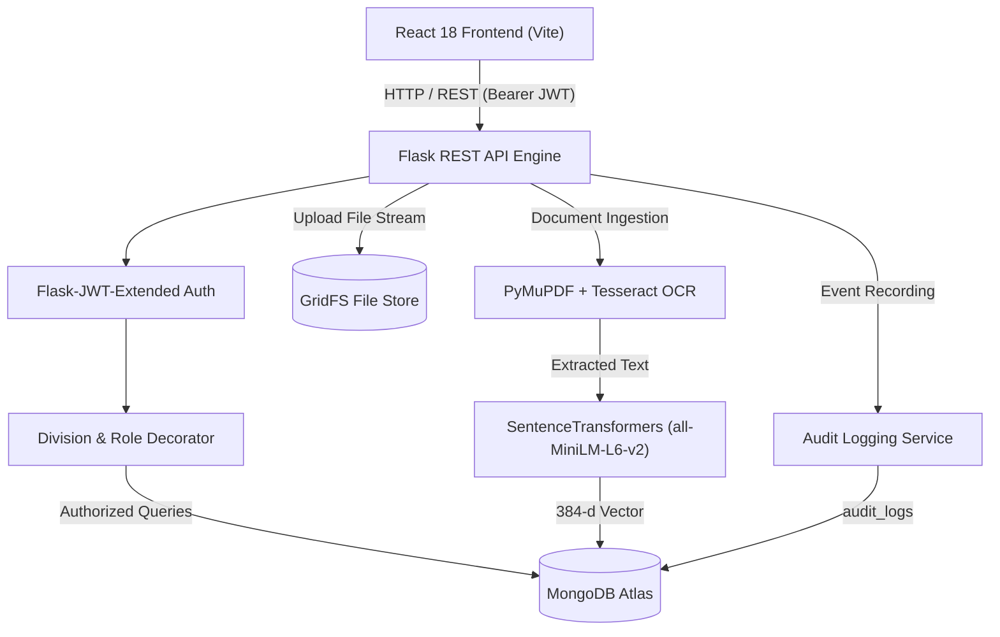
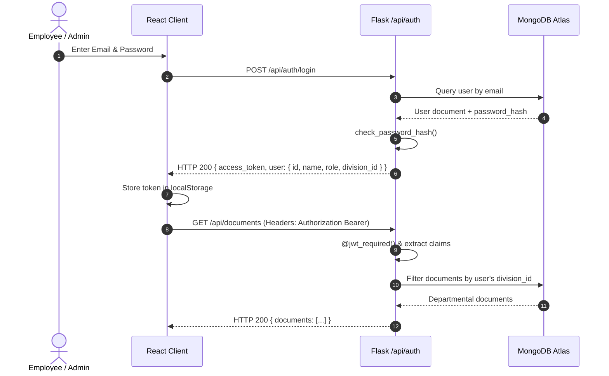
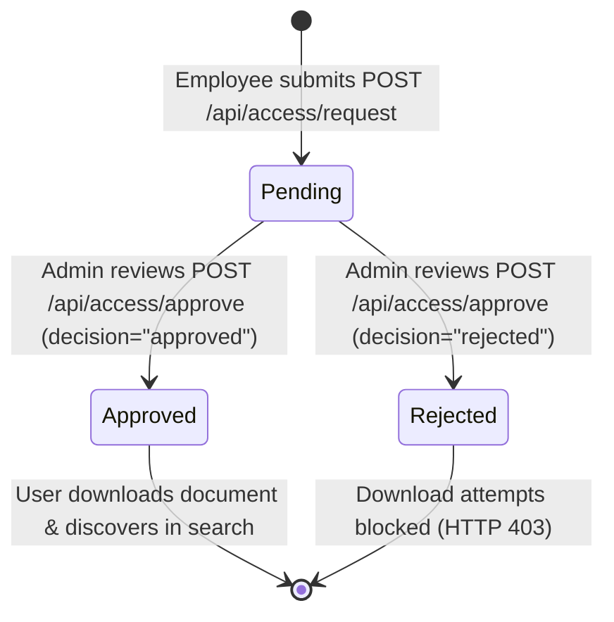

# DocuSphere – Intelligent, Division-Aware Enterprise Document Management System

DocuSphere is a high-security, multi-tenant enterprise Document Management System (DMS) engineered to solve corporate data isolation challenges while facilitating compliant, audited collaboration across business divisions. 

Built with a **Flask (Python 3.12)** REST backend and a **React 18 + Vite** frontend, DocuSphere combines compartmentalized Role-Based Access Control (RBAC), Optical Character Recognition (OCR), AI-powered dense vector semantic search, dynamic metadata management, a cross-division access governance workflow, and an immutable administrative audit trail.

---

## 1. Project Title
**DocuSphere – Intelligent, Division-Aware Enterprise Document Management System**

---

## 2. Project Overview

In traditional corporate repositories, organizations often face a double-edged sword: either documents are siloed in isolated network drives without discoverability, or open repositories inadvertently expose confidential files (e.g., HR personnel records, Finance payroll, Engineering IP) to unauthorized employees.

DocuSphere resolves this by implementing:
1. **Division-First Multi-Tenancy**: Every user and document belongs to a corporate division (e.g., Engineering, Finance, Human Resources). Data isolation is strictly enforced at the database query level.
2. **Automated Document Digitization (OCR)**: Scanned PDFs and raster images are ingested, text is extracted via selectable text layers or Tesseract OCR, and content is indexed for instant search.
3. **AI Dense Vector Semantic Search**: Beyond exact keyword matching, DocuSphere embeds document content using Sentence Transformers (`all-MiniLM-L6-v2`) into 384-dimensional dense vectors to support natural language queries and hybrid keyword/semantic search.
4. **Governed Cross-Division Workflow**: When employees require documents outside their division, they cannot access them directly. Instead, they submit formal business justification requests that administrators review, approve, or reject.
5. **Tamper-Evident Audit Trail**: Every upload, download, access request, approval, and rejection is recorded with actor metadata and timestamps, presented in an Admin Audit Log Viewer.

> [!NOTE]
> This application is an enterprise architectural implementation designed for deployment and customization within corporate networks. It is not intended as an off-the-shelf SaaS binary without organization-specific security configurations.

---

## 3. Key Features

- **Strict Division-Based Access Control**:
  - Departmental data fencing between Engineering, Finance, and Human Resources.
  - Zero cross-division leakage: users only query, view, and download documents belonging to their assigned division.
  - System administrators possess universal cross-division visibility.
- **Dynamic Configurable Metadata**:
  - Administrators configure custom metadata schemas (text fields, required dropdowns) through the UI and REST API.
  - Real-time client and backend validation prevents document uploads when required metadata fields are missing or invalid.
- **Dual-Pass OCR Engine**:
  - High-performance text extraction for PDF, PNG, JPEG, and TIFF files.
  - Direct digital text extraction via PyMuPDF with automatic fallback to Tesseract OCR for scanned/raster pages.
- **AI-Powered Multi-Modal Search**:
  - **Keyword Search**: Regex-based search matching filenames, OCR-extracted text, and dynamic metadata fields.
  - **Semantic AI Search**: Real-time query embedding and cosine similarity ranking against precomputed 384-dimensional document vectors.
  - **Hybrid Search**: Tunable weighted fusion combining lexical keyword scores and vector similarity scores with automatic context snippet extraction.
- **Cross-Division Access Governance**:
  - Standalone and document-row access request submission with justification reasons.
  - Administrative review inbox for approving or rejecting requests.
  - Temporary or persistent permission granting: approved requests immediately unlock cross-division document downloads and semantic search discoverability.
- **Enterprise Audit Logging & Admin Viewer**:
  - Automatic event logging for uploads, downloads, access requests, and approval decisions.
  - Dedicated Admin Audit Log Viewer featuring real-time refresh, action filtering, pagination, and raw JSON payload inspection.
  - Sanitized audit records: zero sensitive credentials or JWT secrets are ever stored or exposed.

---

## 4. Technology Stack

### Backend
| Technology | Version | Purpose |
|---|---|---|
| **Python** | 3.12+ | Core backend runtime |
| **Flask** | 3.0.x | REST API microframework and blueprint routing |
| **Flask-JWT-Extended** | 4.6.x | Stateless JWT authentication, token issuance, and claim verification |
| **Flask-CORS** | 4.0.x | Cross-Origin Resource Sharing handling for React client |
| **PyMongo & GridFS** | 4.8.x | MongoDB Atlas driver and chunked binary file storage |
| **PyMuPDF (fitz)** | 1.24.x | Digital PDF parsing and raster rendering |
| **pytesseract & Pillow** | 0.3.13 / 10.x | Image preprocessing and Optical Character Recognition |
| **Sentence-Transformers** | 3.0.x | Neural embedding generation via `all-MiniLM-L6-v2` |
| **PyTorch & NumPy** | 2.x / 1.x | Vector operations, L2 normalization, and cosine similarity |
| **Werkzeug** | 3.0.x | Secure password hashing (`pbkdf2:sha256`) and filename sanitization |

### Frontend
| Technology | Version | Purpose |
|---|---|---|
| **React** | 18.3.x | Component-based user interface |
| **Vite** | 5.4.x | Fast build tool and frontend development server |
| **React Router DOM** | 6.26.x | Single Page Application (SPA) client-side routing |
| **Axios** | 1.7.x | HTTP client with automatic JWT request/response interceptors |
| **Lucide React** | 0.441.x | Enterprise UI icon suite |
| **Vanilla CSS3** | — | Custom responsive enterprise design system (`global.css`) |

### Database & External Services
| Component | Implementation |
|---|---|
| **Database** | MongoDB Atlas (Cloud Multi-Node Replica Set, TLS/SSL) |
| **Object Store** | MongoDB GridFS (`fs.files`, `fs.chunks`) |
| **OCR Engine** | Tesseract OCR v5.x binary on host OS |

---

## 5. System Architecture



---

## 6. Project Folder Structure

```
DocuSphere/
├── backend/
│   ├── app/
│   │   ├── routes/
│   │   │   ├── __init__.py
│   │   │   ├── access.py          # Cross-division access requests & review
│   │   │   ├── audit.py           # Admin audit log viewer API
│   │   │   ├── auth.py            # Registration, login, profile (/me)
│   │   │   ├── divisions.py       # Corporate divisions listing & seeding
│   │   │   ├── documents.py       # Upload, download, repository listing
│   │   │   ├── health.py          # Health check & database ping
│   │   │   ├── metadata.py        # Dynamic metadata schema configuration
│   │   │   └── search.py          # Keyword, semantic vector, and hybrid search
│   │   ├── services/
│   │   │   ├── embedding_service.py # Sentence Transformers & cosine similarity
│   │   │   └── ocr_service.py       # PyMuPDF and Tesseract OCR engine
│   │   ├── utils/
│   │   │   ├── audit.py           # Audit event recording helper
│   │   │   └── decorators.py      # @role_required, @division_required
│   │   ├── __init__.py            # Application factory & blueprint registration
│   │   ├── config.py              # Environment configuration loader
│   │   └── extensions.py          # MongoDB client, GridFS, & database indexes
│   ├── scripts/
│   │   ├── backfill_embeddings.py # Backfill embeddings for existing documents
│   │   ├── test_phase2_search.py  # Phase 2 backend search tests
│   │   └── test_phase3_frontend_api.py # Phase 3 API tests
│   ├── run.py                     # Backend application entry point (port 5000)
│   └── requirements.txt           # Python backend dependencies
├── frontend/
│   ├── public/
│   ├── src/
│   │   ├── api/
│   │   │   ├── accessApi.js       # Access request endpoints
│   │   │   ├── auditApi.js        # Admin audit log endpoints
│   │   │   ├── authApi.js         # Authentication endpoints
│   │   │   ├── axios.js           # Authenticated Axios client & interceptor
│   │   │   ├── divisionsApi.js    # Divisions endpoints
│   │   │   ├── documentApi.js     # Document management endpoints
│   │   │   ├── metadataApi.js     # Metadata configuration endpoints
│   │   │   └── searchApi.js       # Search API dispatcher (keyword/semantic/hybrid)
│   │   ├── components/
│   │   │   ├── DocumentPreviewModal.jsx
│   │   │   ├── DocumentTable.jsx
│   │   │   ├── LoadingSpinner.jsx
│   │   │   ├── MetadataForm.jsx
│   │   │   ├── Navbar.jsx
│   │   │   ├── ProtectedRoute.jsx
│   │   │   ├── RequestAccessModal.jsx
│   │   │   ├── Sidebar.jsx        # Role-aware sidebar navigation
│   │   │   └── StatCard.jsx
│   │   ├── context/
│   │   │   ├── AuthContext.jsx    # User session, JWT tokens, and roles
│   │   │   └── ToastContext.jsx   # Global UI notifications
│   │   ├── layouts/
│   │   │   └── DashboardLayout.jsx# Authenticated shell layout
│   │   ├── pages/
│   │   │   ├── AccessRequests.jsx # Request access & review approval inbox
│   │   │   ├── AdvancedSearch.jsx # Multi-modal search interface
│   │   │   ├── AuditLogs.jsx      # Admin audit trail viewer
│   │   │   ├── Dashboard.jsx      # Overview metrics & quick access
│   │   │   ├── DocumentDetails.jsx# Metadata & download inspector
│   │   │   ├── Documents.jsx      # Division document repository
│   │   │   ├── Login.jsx          # User login
│   │   │   ├── Settings.jsx       # Metadata, divisions, and security settings
│   │   │   ├── Signup.jsx         # User registration
│   │   │   └── UploadDocument.jsx # Document upload with dynamic validation
│   │   ├── styles/
│   │   │   └── global.css         # Enterprise design system
│   │   ├── App.jsx                # Application routing configuration
│   │   └── main.jsx               # React entry point
│   ├── index.html
│   ├── package.json               # Node.js dependencies & scripts
│   └── vite.config.js             # Vite configuration
└── README.md                      # Project documentation
```

---

## 7. Backend Setup and Installation

### Prerequisites
- Python 3.12 or higher installed on your system.
- PowerShell on Windows (or Bash on Linux/macOS).
- MongoDB Atlas cluster connection string.
- Tesseract OCR installed on the host operating system.

### Installation Steps (Windows PowerShell)

1. Open PowerShell and navigate to the `backend` directory:
   ```powershell
   cd "C:\Users\naush\DocuSphere\backend"
   ```

2. Create a dedicated Python virtual environment:
   ```powershell
   python -m venv venv
   ```

3. Activate the virtual environment:
   ```powershell
   .\venv\Scripts\Activate.ps1
   ```

4. Upgrade `pip` to the latest version:
   ```powershell
   python -m pip install --upgrade pip
   ```

5. Install backend dependencies from `requirements.txt`:
   ```powershell
   pip install -r requirements.txt
   ```

---

## 8. Frontend Setup and Installation

### Prerequisites
- Node.js (v18.x or v20.x LTS recommended).
- `npm` package manager.

### Installation Steps (Windows PowerShell)

1. Open PowerShell and navigate to the `frontend` directory:
   ```powershell
   cd "C:\Users\naush\DocuSphere\frontend"
   ```

2. Install Node dependencies from `package.json`:
   ```powershell
   npm install
   ```

---

## 9. Environment Configuration

### Backend Configuration (`backend/.env`)
Create a file named `.env` inside `C:\Users\naush\DocuSphere\backend\.env`:

```ini
# Flask Secret Key for session signing
SECRET_KEY=your_secure_flask_secret_key_here

# JWT Signing Secret Key
JWT_SECRET_KEY=your_secure_jwt_secret_key_here

# MongoDB Atlas Connection String (SRV format with TLS)
MONGO_URI=mongodb+srv://<username>:<password>@cluster0.example.mongodb.net/?retryWrites=true&w=majority

# Target Database Name
MONGO_DB_NAME=docusphere_db

# Allowed Frontend Origin for CORS
FRONTEND_URL=http://localhost:5173
```

> [!CAUTION]
> Never commit actual passwords, private database connection strings, or JWT secret keys to source control. The `.env` file is excluded via `.gitignore`.

### Frontend Configuration (`frontend/.env`)
Create a file named `.env` inside `C:\Users\naush\DocuSphere\frontend\.env`:

```ini
# Base URL for the Flask API Backend
VITE_API_BASE_URL=http://127.0.0.1:5000
```

---

## 10. MongoDB Atlas and GridFS Configuration

DocuSphere utilizes MongoDB Atlas over encrypted TLS for structured metadata and MongoDB GridFS for large document binary storage.

### Collections Structure
- `users`: User profiles, bcrypt password hashes, role (`admin`, `division_admin`, `employee`), and division binding.
- `divisions`: Corporate divisions (`Engineering`, `Finance`, `Human Resources`).
- `documents`: Document records containing filenames, MIME types, division IDs, dynamic metadata dictionaries, OCR-extracted text, and dense vector embeddings.
- `metadata_fields`: Configured dynamic metadata field definitions and allowed validation options.
- `access_requests`: Formal access requests between users and out-of-division documents.
- `audit_logs`: Immutable chronological log of all security and data governance actions.
- `fs.files` & `fs.chunks`: GridFS chunked binary storage for uploaded document files.

### Database Indexes (`backend/app/extensions.py`)
Upon application startup, `init_db()` verifies and initializes critical indexes:
1. `db.users`: `email` (Unique ascending).
2. `db.access_requests`: `active_request_key` (Unique ascending with partial filter expression for active strings).
3. `db.documents`: `division_id` (Ascending) + `_id` (Descending) for rapid departmental listing.
4. `db.documents`: `filename` (Ascending).
5. `db.audit_logs`: `created_at` (Descending) index (`audit_created_at_desc`) checked and created if not present.

---

## 11. OCR Setup and Tesseract Installation

DocuSphere employs a dual-pass extraction strategy implemented in [ocr_service.py](file:///C:/Users/naush/DocuSphere/backend/app/services/ocr_service.py):

1. **Digital Parsing Pass**: Uses **PyMuPDF (`fitz`)** to inspect PDF streams. If text is selectable, it is extracted immediately without rasterization.
2. **Raster OCR Pass**: If a PDF page is scanned or contains no selectable text (or if the upload is an image), the page is rendered to high-resolution pixmaps (`Matrix(2, 2)`) and processed with **Tesseract OCR**.

### Host Tesseract Configuration
Tesseract OCR must be installed on the host system:
- **Default Windows Path**: `C:\Program Files\Tesseract-OCR\tesseract.exe`
- If Tesseract is installed at the default location, `ocr_service.py` automatically binds `pytesseract.pytesseract.tesseract_cmd = TESSERACT_PATH`.
- Supported Image MIME Types: `image/png`, `image/jpeg`, `image/tiff`.

---

## 12. Authentication and Role-Based Access Control

DocuSphere implements stateless JSON Web Token (JWT) authentication:



### Roles and Permissions Matrix
| Capability | Employee | Division Admin | System Admin |
|---|:---:|:---:|:---:|
| View documents in own division | Yes | Yes | Yes |
| View documents across all divisions | No | No | Yes |
| Upload documents to own division | Yes | Yes | Yes |
| Download documents in own division | Yes | Yes | Yes |
| Request cross-division document access | Yes | Yes | Yes |
| Approve/reject access requests for own division | No | Yes | Yes |
| Approve/reject access requests enterprise-wide | No | No | Yes |
| Create/configure dynamic metadata fields | No | No | Yes |
| Access the Audit Log Viewer | No | No | Yes |

---

## 13. Division-Based Document Management

All document access is compartmentalized by `division_id`. 

- **Upload Pipeline**:
  1. User selects a file and enters dynamic metadata.
  2. Frontend sends multipart `POST /api/documents/upload`.
  3. Backend verifies user authentication and active division.
  4. Backend runs dynamic metadata validation against `db.metadata_fields`.
  5. File bytes are written to GridFS (`fs.put`).
  6. OCR text extraction is executed in-process.
  7. SentenceTransformer embedding is generated from extracted text (384-d).
  8. Document record is saved to `db.documents` with `division_id = user["division_id"]`.
  9. An audit event `document_uploaded` is committed.
- **Download Security**:
  - Direct downloads via `GET /api/documents/<doc_id>/download` verify whether the requester belongs to the owning division.
  - If from another division, the endpoint queries `db.access_requests` for an `approved` record for that user. If not found, `HTTP 403 Forbidden` is returned.

---

## 14. Cross-Division Access Request and Approval Workflow

When a user requires access to a file outside their department, DocuSphere enforces a closed-loop governance workflow:



1. **Submission**: User calls `POST /api/access/request` with `document_id` and `reason`.
2. **Concurrency Control**: A unique index on `active_request_key` (`<user_id>_<document_id>_pending`) prevents duplicate simultaneous pending requests.
3. **Inbox Review**: Administrators access `GET /api/access/inbox`.
4. **Decision**: Calling `POST /api/access/approve` with `decision: "approved"` or `"rejected"` resolves the request, updates timestamps, and records an audit log entry.
5. **Enforcement**: Approved users can immediately download the document and find it via semantic search.

---

## 15. Dynamic Metadata Management

DocuSphere decouples document schemas from static code:

- **Configuration**: System administrators define fields in [Settings.jsx](file:///C:/Users/naush/DocuSphere/frontend/src/pages/Settings.jsx) or via `POST /api/metadata/fields`.
  - Standard configured fields:
    - `report_type`: Dropdown, `required = True`, Options: `Test Report`, `Technical Report`, `Financial Report`, `Research Report`.
    - `project_code`: Text, `required = False`.
- **Validation**: When uploading, `backend/app/routes/documents.py` validates that all fields with `required: True` are present and that dropdown selections match allowed options. Non-compliant uploads are rejected with `HTTP 400 Bad Request`.

---

## 16. Keyword Search, AI Semantic Search, and Hybrid Search

DocuSphere provides three distinct search modes in [AdvancedSearch.jsx](file:///C:/Users/naush/DocuSphere/frontend/src/pages/AdvancedSearch.jsx):

### 1. Keyword Search (`GET /api/search?q=<query>`)
- Searches lexical regex matches across `filename`, `extracted_text`, and all configured `metadata.<key>` fields.
- Non-admin queries are strictly constrained to `query["division_id"] = user["division_id"]`.

### 2. Semantic AI Search (`GET /api/search/semantic?q=<query>`)
- Utilizes the **Sentence Transformers `all-MiniLM-L6-v2`** model.
- During search, query text is embedded into a unit-normalized 384-dimensional vector.
- Cosine similarity is computed against precomputed document embeddings using vector dot products (`np.dot(u, v)`).
- Result documents are ranked strictly in descending order of similarity score.
- Returns semantic snippets extracted by segmenting document text and locating the sentence with maximum semantic affinity to the query.

### 3. Hybrid Search (`GET /api/search/hybrid?q=<query>`)
- Combines keyword frequency scoring and neural semantic similarity.
- Configurable weights (default: `kw_weight = 0.4`, `sem_weight = 0.6`).
- Documents are scored using:
  $$\text{combined\_score} = (\text{kw\_weight} \times \text{keyword\_score}) + (\text{sem\_weight} \times \text{semantic\_score})$$
- Context snippets automatically highlight matched keyword patterns or fallback to semantic context windows.

### Embedding Backfill Script
For existing documents uploaded before embeddings were enabled, run the backfill utility:
```powershell
cd "C:\Users\naush\DocuSphere\backend"
.\venv\Scripts\python.exe scripts\backfill_embeddings.py
```
Pass `--force` to recompute embeddings for all documents.

---

## 17. Audit Logging and Admin Audit Log Viewer

Located in [backend/app/routes/audit.py](file:///C:/Users/naush/DocuSphere/backend/app/routes/audit.py) and [frontend/src/pages/AuditLogs.jsx](file:///C:/Users/naush/DocuSphere/frontend/src/pages/AuditLogs.jsx):

- **Logged Actions**:
  - `document_uploaded`: Records filename, content type, OCR status, text length.
  - `document_downloaded`: Records filename, division, access type (`same_division` vs `approved_cross_division`).
  - `access_request_created`: Records target document ID, justification reason.
  - `access_request_approved` / `access_request_rejected`: Records reviewer ID and decision.
- **Security & Data Sanitization**:
  - The endpoint `GET /api/admin/audit-logs` is protected with `@role_required("admin")`.
  - Sensitive keys (`password`, `password_hash`, `token`, `secret`, `api_key`) are stripped before transmission.
  - Resolves human-readable `actor_name`, `actor_email`, and `document_filename` while handling deleted or missing references gracefully.

---

## 18. API Documentation – Implemented Endpoints

All endpoints below have been verified against the backend routing implementation:

| Module | Method | Endpoint | Auth Required | Description |
|---|:---:|---|:---:|---|
| **Health** | `GET` | `/api/health` | No | Pings MongoDB and returns API status |
| **Auth** | `POST` | `/api/auth/register` | No | Registers new user account with division binding |
| **Auth** | `POST` | `/api/auth/login` | No | Authenticates credentials and returns JWT token |
| **Auth** | `GET` | `/api/auth/me` | JWT | Returns current authenticated user profile & division |
| **Auth** | `GET` | `/api/auth/admin-test` | JWT (Admin) | Verifies administrator authorization decorator |
| **Divisions**| `GET` | `/api/divisions/` | No | Retrieves all corporate divisions |
| **Divisions**| `POST` | `/api/divisions/seed` | No | Seeds default divisions (Engineering, Finance, HR) |
| **Documents**| `POST` | `/api/documents/upload` | JWT | Ingests file, runs OCR & embedding, validates metadata |
| **Documents**| `GET` | `/api/documents/` | JWT | Lists repository documents scoped by division/role |
| **Documents**| `GET` | `/api/documents/<doc_id>/download` | JWT | Streams file from GridFS with division/approval checks |
| **Metadata** | `GET` | `/api/metadata/fields` | JWT | Retrieves active dynamic metadata fields |
| **Metadata** | `POST` | `/api/metadata/fields` | JWT (Admin) | Configures a new dynamic metadata field |
| **Access** | `POST` | `/api/access/request` | JWT | Creates a cross-division document access request |
| **Access** | `GET` | `/api/access/inbox` | JWT (Admin) | Retrieves pending requests for administrative review |
| **Access** | `POST` | `/api/access/approve` | JWT (Admin) | Approves or rejects a cross-division access request |
| **Access** | `GET` | `/api/access/my-requests` | JWT | Returns current user's submitted access requests |
| **Search** | `GET` | `/api/search` | JWT | Exact lexical keyword search across documents |
| **Search** | `GET` | `/api/search/semantic` | JWT | AI dense vector semantic search with cosine similarity |
| **Search** | `GET` | `/api/search/hybrid` | JWT | Weighted hybrid lexical + semantic search |
| **Audit** | `GET` | `/api/admin/audit-logs` | JWT (Admin) | Returns paginated audit trail with filters |
| **Audit** | `GET` | `/api/audit/logs` | JWT (Admin) | Alias route for admin audit logs |

---

## 19. Running the Application

### 1. Start the Flask Backend Server
In PowerShell:
```powershell
cd "C:\Users\naush\DocuSphere\backend"
.\venv\Scripts\Activate.ps1
python run.py
```
*The backend server initializes on `http://127.0.0.1:5000`.*

### 2. Start the React Frontend Development Server
In a separate PowerShell window:
```powershell
cd "C:\Users\naush\DocuSphere\frontend"
npm run dev
```
*The frontend development server initializes on `http://localhost:5173`.*

---

## 20. Testing and Verification

DocuSphere includes comprehensive automated integration test suites.

### Running Backend Integration Tests
Execute the verification suite from the backend directory:
```powershell
cd "C:\Users\naush\DocuSphere\backend"
.\venv\Scripts\Activate.ps1

# Run search verification tests
python scripts\test_phase2_search.py

# Run access control & workflow verification tests
python test_access_workflow.py

# Run upload & keyword search tests
python scripts\test_upload_and_keyword_search.py
```

### Running Frontend Production Build Verification
Confirm the frontend compiles with zero JSX or bundling errors:
```powershell
cd "C:\Users\naush\DocuSphere\frontend"
npm run build
```

---

## 21. Screenshots

The following interface views illustrate DocuSphere's design system:

### 1. Authentication & Role Selection
*User login and registration with corporate division binding.*
```
[ SCREENSHOT PLACEHOLDER: Login & Signup Screen ]
```

### 2. Dashboard View
*System overview with division metrics, recent documents, and quick action cards.*
```
[ SCREENSHOT PLACEHOLDER: Dashboard with Division Overview ]
```

### 3. Document Repository
*Department-scoped document repository displaying OCR status badges and metadata.*
```
[ SCREENSHOT PLACEHOLDER: Document Repository Table ]
```

### 4. Upload Document with Dynamic Metadata Validation
*Upload form rendering dynamic fields and validating required indicators.*
```
[ SCREENSHOT PLACEHOLDER: Upload Document Form with Dynamic Fields ]
```

### 5. Advanced Search (Keyword, Semantic AI, and Hybrid)
*Multi-modal search view showcasing natural language queries and ranked cosine similarity.*
```
[ SCREENSHOT PLACEHOLDER: Advanced Search Interface with Semantic Ranking ]
```

### 6. Cross-Division Access Requests & Approval Inbox
*Access request modal and administrative review inbox for processing permissions.*
```
[ SCREENSHOT PLACEHOLDER: Access Requests Inbox & Review Modal ]
```

### 7. Admin Audit Log Viewer
*Administrative security viewer displaying chronological actions, filters, and raw payload inspect modal.*
```
[ SCREENSHOT PLACEHOLDER: Admin Audit Trail and Event Inspection Modal ]
```

---

## 22. Security Considerations

- **Password Cryptography**: User passwords are never stored in plaintext. Werkzeug's `generate_password_hash` with `pbkdf2:sha256` ensures brute-force resilience.
- **Stateless JWT Claims**: Authentication tokens are signed with HMAC-SHA256. User roles and division IDs are stored as verified claims and cross-checked in the database.
- **Database-Level Isolation**: Document listings and search queries enforce division filters in MongoDB queries, preventing client-side bypasses.
- **GridFS Storage Protection**: File binaries cannot be accessed by raw GridFS ID without going through authenticated Flask routes with ownership/approval validation.
- **Regex Injection Prevention**: All user search queries are escaped using `re.escape()` before being evaluated in MongoDB `$regex` pipelines.
- **Audit Sanitization**: Audit logs automatically strip authorization headers, passwords, and tokens before persistence.

---

## 23. Troubleshooting

### 1. Tesseract OCR Not Found
- **Symptom**: Scanned PDFs return `ocr_status: "failed"` with `tesseract is not installed or it's not in your PATH`.
- **Fix**: Verify Tesseract is installed at `C:\Program Files\Tesseract-OCR\tesseract.exe`. If installed in another folder, update `TESSERACT_PATH` in `backend/app/services/ocr_service.py` or add Tesseract to your Windows system `PATH`.

### 2. MongoDB Atlas Connection Timeout
- **Symptom**: `ServerSelectionTimeoutError` or SSL alert on startup.
- **Fix**: Ensure your current IP address is whitelisted in MongoDB Atlas Network Access (`0.0.0.0/0` for development). Verify `MONGO_URI` contains `retryWrites=true&w=majority`.

### 3. Cross-Division Download Returns 403
- **Symptom**: `{"status": "error", "message": "Cross-division access restricted"}`.
- **Fix**: The requested document belongs to another division. Submit an access request via the UI or `POST /api/access/request` and have an administrator approve it first.

### 4. CORS Errors on Frontend
- **Symptom**: Browser console indicates `Cross-Origin Request Blocked`.
- **Fix**: Verify that `FRONTEND_URL` in `backend/.env` exactly matches the running Vite client URL (`http://localhost:5173`).

---

## 24. Future Enhancements

The following roadmap items represent potential architectural extensions beyond the current verified implementation:

- **Asynchronous Task Queue (Celery + Redis)**: Offload high-volume OCR rasterization and batch embedding generation to asynchronous background worker queues.
- **Vector Database Indexing**: Transition in-memory dot product ranking to native MongoDB Atlas Vector Search or specialized vector stores (e.g., Milvus, Qdrant).
- **Document Versioning & Soft Deletes**: Track revisions for uploaded documents with full historical diffing and reversible deletions.
- **Fine-Grained Permission Delegation**: Enable division admins to delegate review authority to specific team leads within their division.
- **Two-Factor Authentication (2FA/TOTP)**: Integrate Time-based One-Time Passwords for administrator logins and sensitive document exports.

---

*DocuSphere – Enterprise Document Management System © 2026.*
